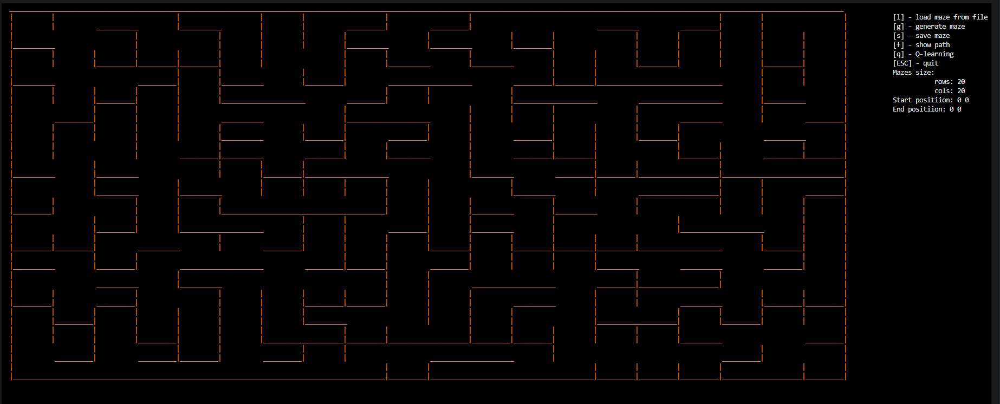

# A1 Maze

Учебный проект на C с терминальным интерфейсом ncurses. Генерирует лабиринты алгоритмом Эллера, загружает и сохраняет их в текстовом формате и ищет маршрут между двумя клетками волновым алгоритмом. В коде есть режим пещер на клеточном автомате и эксперимент с Q-learning: во время обучения видно движение агента, а маршрут после обучения строится волновым алгоритмом.

## Скриншоты


*Лабиринт 20×20. Справа — доступные команды.*


*Стартовый экран: сгенерировать лабиринт или открыть файл.*

## Сборка и запуск

Нужны GCC, GNU Make и библиотека ncurses с заголовками. Из папки `A1`:

```sh
make -C src install
make -C src run
```

Для `make -C src test` дополнительно нужна библиотека Check. Смотри на число ошибок в выводе Check: Makefile может завершиться успешно даже при упавшем тесте. Штатная сборка и тесты на `9b081c3` не проверялись.

[Алгоритмы](./src/backend/) · [Интерфейс](./src/gui/) · [Тесты](./src/tests/)
